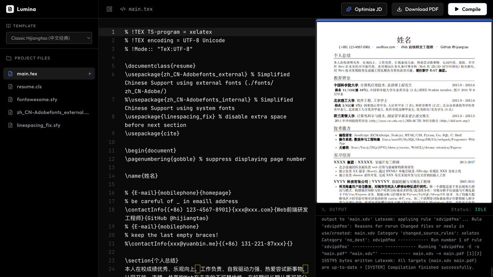

<p align="center">
  
</p>
<p align="center">
  
  
  
  
  
</p>

<h1 align="center">AI 智能简历构建器</h1>

<p align="center">
  在浏览器里写 LaTeX 简历：左边改代码，右边实时出 PDF，<br>
  再让 AI 按职位描述帮你逐条改——界面品牌名 <strong>Lumina</strong>。
</p>

<p align="center">
  
</p>

---

**目录**：[快速启动](#快速启动) · [核心特性](#核心特性) · [技术架构](#技术架构) · [端到端测试](#端到端测试) · [注意事项](#注意事项) · [参与贡献](#参与贡献) · [开源协议](#开源协议)

## 快速启动
### 环境要求

| | |
|---|---|
| Python | 3.10 及以上 |
| Node.js | 18 及以上 |
| LaTeX | Tectonic 或任一带 `latexmk` 的 TeX 发行版（见[注意事项](#注意事项)） |
| LLM | 一个 OpenAI 兼容接口的 API Key（仅 AI 优化功能需要，编译 PDF 不需要） |

### 1. 后端

```bash
cd backend
pip install -r requirements.txt

export OPENAI_API_KEY="your-api-key"
export OPENAI_BASE_URL="https://your-llm-provider.com/v1"

uvicorn app.main:app --host 127.0.0.1 --port 8000 --reload
```

### 2. 前端

```bash
cd frontend
npm install
npm run dev
```

浏览器打开 `http://localhost:3000`（控制台若提示 3001 则以实际端口为准）。Vite 已配好 `/api` 到 `127.0.0.1:8000` 的代理，前后端各自启动即可，不用手动拼端口。

不配 `OPENAI_API_KEY` 也能正常写代码、编译 PDF、下载 PDF——只有「Optimize JD」按钮需要 Key。


## 核心特性
- **Monaco 编辑器写 LaTeX** — 就是 VS Code 那个编辑器：语法高亮、自动补全、括号匹配，写 `.tex` 不再是记事本体验。
- **改完就出 PDF** — 点 Compile，右侧画布直接渲染编译结果，不用切窗口、不用手动开阅读器。
- **中文开箱即用** — 内置 `ctex` / `xeCJK` 与 Fandol 字体，专治云端和 Linux 上臭名昭著的中英文混排错位和 `nullfont` 报错。
- **AI 按 JD 改简历** — 贴上职位描述，AI（支持 DeepSeek、智谱 GLM 等任何 OpenAI 兼容接口）分析匹配度，在左右双栏的 Diff 视图里说明每处改动的理由，比如「用 STAR 法则重写」「突出量化数据」。
- **改坏了能退回去** — 应用修改时会另存为带时间戳的专属版本（`main_tailored_1719xxx.tex`），原始底稿永远保留，不覆盖。
- **多套模板切换** — 内置中文经典、Awesome-CV 等模板，左上角一键换。


## 技术架构
| 层 | 选型 |
|---|---|
| 前端 | React 18 · Vite · TailwindCSS v4 · Monaco Editor · react-pdf · Lucide Icons |
| 后端 | FastAPI (Python 3.10+) · Uvicorn |
| LaTeX | Tectonic（自包含、自动下载宏包），失败时回退系统 `latexmk` |
| AI | 标准 OpenAI 接口规范，可接任何兼容供应商（DeepSeek、智谱 GLM、Paratera 等） |

**编译为什么不会超时**：大模型改几千字 LaTeX 可能跑几分钟，所以从前端 Axios → Vite 代理 → FastAPI 路由 → 后端 OpenAI 客户端，整条链路都配了 3 分钟防 504 熔断。


## 端到端测试
项目带一套 Playwright E2E，真实模拟「填 JD → 等 AI 响应 → 应用修改」的全流程：

```bash
pip install playwright requests
playwright install chromium

# 确保前后端已启动
python test_jd_optimizer.py
```


## 注意事项
- **`bin/tectonic` 是 Linux 二进制，macOS / Windows 上会直接 `exec format error`。** 编译策略是先找系统 `latexmk`，找不到才用 `bin/tectonic`——所以在 macOS 上要么装 TeX Live（`brew install --cask mactex-no-gui`），要么 `brew install tectonic` 后把 `bin/tectonic` 换成本机二进制或软链。
- AI 优化会把你粘贴的 JD 和简历内容发给你配置的供应商，注意别贴涉密信息。
- 编译产物在 `backend` 的临时工作目录里，清理磁盘时可以一并删掉。


## 参与贡献
欢迎提 Issue 或直接发起 Pull Request。


## 开源协议
[MIT](./LICENSE)
